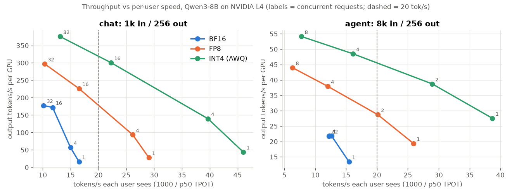
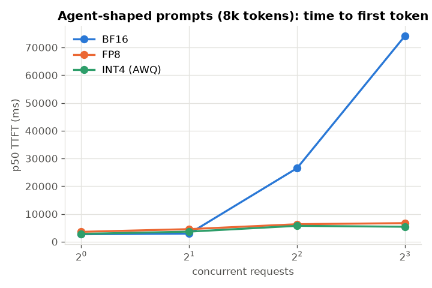
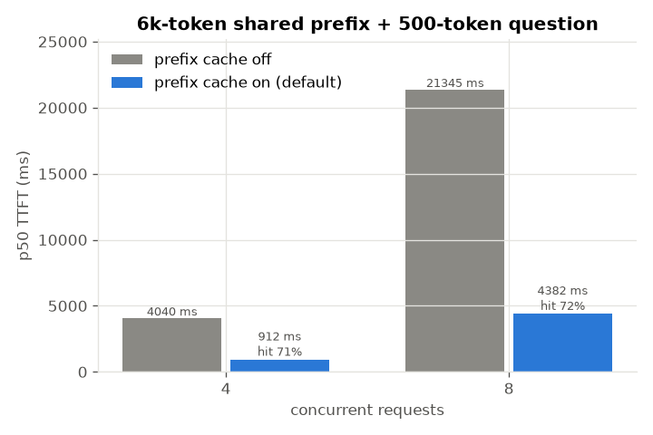
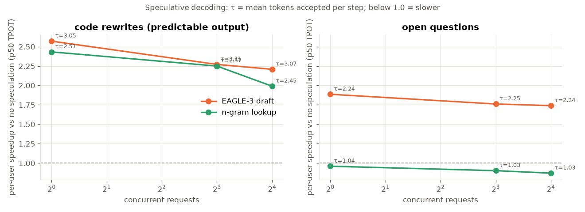

# llm-systems-lab

Hands-on measurements of LLM serving, run on rented or Colab GPUs. I make a prediction first, then measure, then
write down where the prediction was wrong.

## serving/: one 8B model, one GPU, five questions

Qwen3-8B on vLLM 0.32.0, measured with `vllm bench serve`. The first full run used an **NVIDIA L4 (24 GB)**: 46
runs, about $0.44/GPU-hour. On a 24 GB card the notebook uses its "small" profile, so the concurrency sweep stops at
32 instead of 128.

| # | Question | Experiment |
|---|---|---|
| 1 | How many users can one GPU serve, and how fast does the GPU feel to each of them? | concurrency sweep, 1k-token chat prompts |
| 2 | Does a smaller number format pay off? | same sweep in BF16, FP8 and INT4 (AWQ) |
| 3 | What do long agent prompts cost? | 8k-token prompts vs 1k |
| 4 | What does a shared system prompt save? | prefix caching on vs off, 6k-token shared prefix |
| 5 | When does speculative decoding help? | EAGLE-3 draft and n-gram lookup, on code rewrites vs open questions |

### Headline numbers (L4)

- **Precision matters most on a small GPU.** At one user, BF16 gives 16 tok/s, FP8 gives 29 and INT4 gives 46. At 32
  concurrent chats the GPU produces 178, 297 and 376 tok/s in total. Smaller weights also leave more room for KV cache:
  23k tokens for BF16, 69k for FP8 and 92k for INT4. I expected INT4 to lose its lead at high concurrency because of
  dequantization. Up to 32 users on an L4, it didn't.
- **Cost:** $0.69 per 1M output tokens for BF16 at peak throughput, $0.41 for FP8 and $0.33 for INT4. With a strict
  latency SLO (p95 TPOT ≤ 50 ms, p95 TTFT ≤ 1 s), BF16 fails even with one user (60 ms per token), and FP8 and INT4
  pass only at concurrency 1.
- **BF16 can't run agents on this card.** BF16's 23k-token KV cache holds about two 8k requests. Above that, requests
  queue: time to first token rises from 2.7 s with one user to 27 s with 4 and 74 s with 8, and throughput stays flat
  at about 22 tok/s. FP8 and INT4 stay at 5–7 s median with 8 users. At one user, an 8k prompt takes about 8× longer
  to reach the first token than a 1k prompt (2.7–3.6 s vs 0.3–0.4 s).
- **Prefix caching cuts time to first token by 4–5×.** It drops from 4.0 s to 0.9 s with 4 users and from 21 s to 4.4 s
  with 8 (cache hit rate 71–72%). Output throughput also rises by 45–80%, more than I predicted.
- **Speculative decoding depends on the text.** On code rewrites, EAGLE-3 makes each user 2.6× faster at concurrency 1
  and still 2.2× faster at 16. The n-gram method gives 2.4× and 2.0×. On open questions EAGLE-3 still gives 1.7–1.9×,
  but n-gram is slower than no speculation (0.87–0.96×), because it almost never guesses right (τ ≈ 1.03). The
  slowdown at high concurrency I expected didn't show up by 16 users. The real limit was memory: the EAGLE-3 draft model
  leaves only 4k tokens of KV cache, so at concurrency 16 its total-throughput gain falls to 1.15× and requests get
  preempted 31 times.

### Charts

| | |
|---|---|
|  | **1. Throughput vs per-user speed.** Each line is a precision and each point is a concurrency level. Moving up means more total tokens/s from the GPU; moving right means each user gets tokens faster. INT4 is above and to the right of the other two everywhere. |
|  | **2. Agent time to first token.** BF16 is fine up to 2 users and then shoots up once its KV cache is full; FP8 and INT4 stay flat. |
|  | **3. Prefix cache off vs on.** The same 6k-token system prompt is computed once instead of for every request. |
|  | **4. Speculative decoding speedup.** Below the dashed line it is slower than plain decoding; τ is the average number of tokens accepted per step. |

### Caveats

One run per setting, and 20–128 prompts per point. Prices are RunPod list prices from October 2026. Only speed was
measured, not output quality: FP8 and INT4 may answer slightly differently. To fit the EAGLE-3 draft model on 24 GB,
both speculative-decoding servers (EAGLE-3 and n-gram) ran with a 4k context, while the BF16 baseline they are
compared with used 12k. Full tables: [`findings.md`](serving/results/L4/findings.md),
[`results.csv`](serving/results/L4/results.csv), and the executed notebook
[`serving_benchmark_L4_executed.ipynb`](serving/serving_benchmark_L4_executed.ipynb).

### Run it

Open `serving/serving_benchmark.ipynb` on a GPU machine (Colab L4/A100, or a pod with compute capability ≥ 8.0) and
run the cells from top to bottom. The notebook embeds `runner.py` and `analyze.py`; after editing those, rebuild it with
`python serving/build_notebook.py`. `serving/tests/fake_vllm.py` stands in for vLLM, so the whole flow can be tested
without a GPU. To redo the analysis from saved results: `python serving/analyze.py serving/results/L4`.
